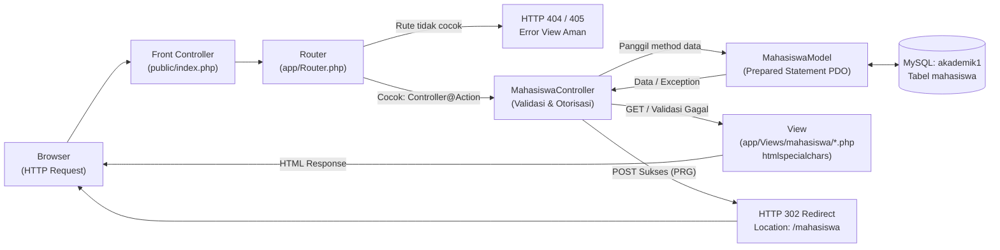
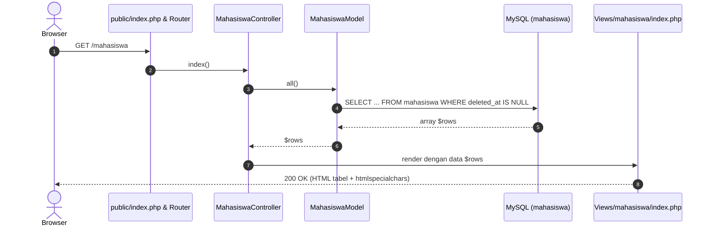
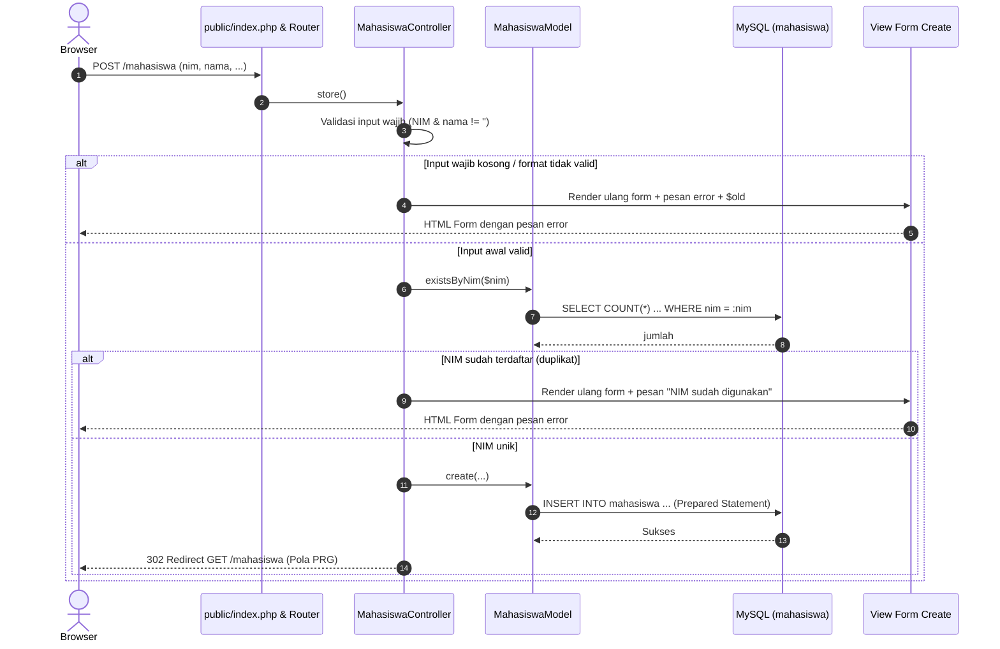
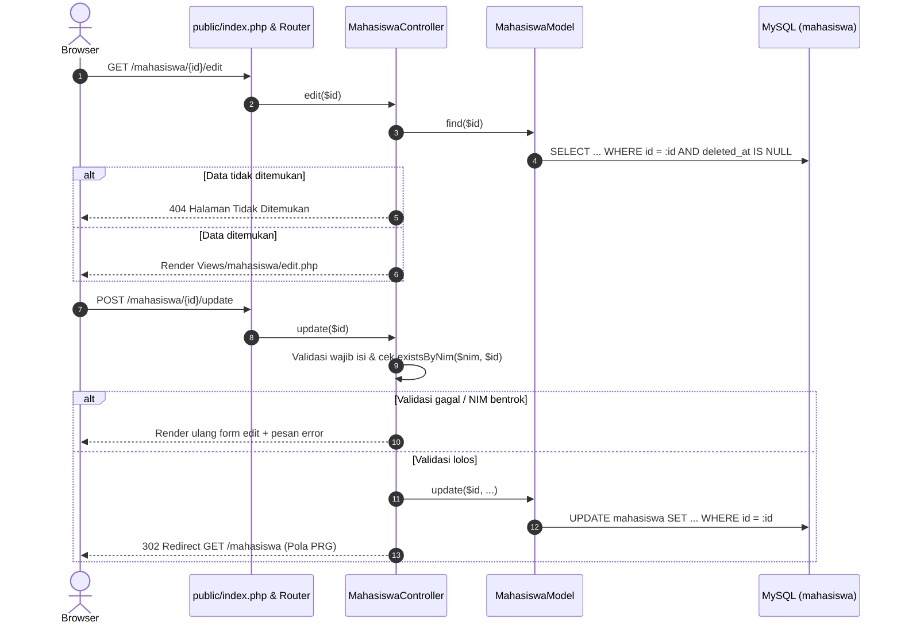
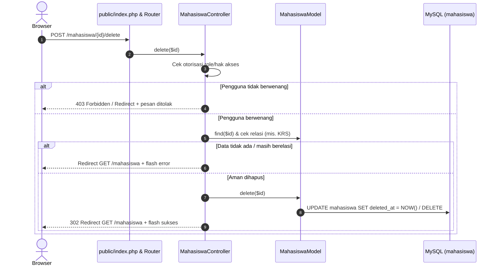

# Output 1 — Diagram Request–Response MVC dan Rute HTTP

Dokumen ini merupakan bagian dari tugas kelompok **Pertemuan 11 — Kasus 1: Pengelolaan Data Mahasiswa (MVC)** untuk memetakan alur *request–response* dan seluruh rute HTTP aplikasi.

---

## 1. Diagram Alur Request–Response MVC (Umum)

---

## 2. Diagram Sequence Per Operasi CRUD & Aturan Simulasi

### 2.1 Menampilkan Daftar Mahasiswa (`GET /mahasiswa`)

### 2.2 Tambah & Validasi Mahasiswa (`POST /mahasiswa`)

Aturan simulasi yang diuji pada alur ini:
1. **NIM dan nama wajib diisi**.
2. **NIM harus unik pada database**.

### 2.3 Ubah Data Mahasiswa (`GET /mahasiswa/{id}/edit` & `POST /mahasiswa/{id}/update`)

### 2.4 Hapus Data Mahasiswa (`POST /mahasiswa/{id}/delete`)

Aturan simulasi yang diuji pada alur ini:
- **Aksi hapus hanya untuk pengguna berwenang** (otorisasi dicek di Controller sebelum memanggil Model).

---

## 3. Tabel Pemetaan Rute HTTP

Seluruh rute masuk melalui *entry point* tunggal `public/index.php` dan dipetakan oleh `app/Router.php`:

| No | HTTP Method | Pola URL | Handler (`Controller@Action`) | Parameter Route | Deskripsi & Respons Sukses | Respons Error / Kasus Kritis |
| :-: | :--- | :--- | :--- | :--- | :--- | :--- |
| 1 | `GET` | `/` | Closure Redirect | - | Redirect `302` ke `/mahasiswa` | - |
| 2 | `GET` | `/mahasiswa` | `MahasiswaController::index()` | - | Menampilkan tabel daftar mahasiswa (dan form tambah sesuai UI Kasus 1) | Daftar kosong menampilkan pesan info; tidak ada SQL di View |
| 3 | `GET` | `/mahasiswa/create` | `MahasiswaController::create()` | - | Menampilkan halaman/form tambah mahasiswa | - |
| 4 | `POST` | `/mahasiswa` | `MahasiswaController::store()` | - | Validasi input → simpan data baru → Redirect `302` ke `/mahasiswa` (PRG) | Render ulang form jika NIM/nama kosong atau NIM duplikat |
| 5 | `GET` | `/mahasiswa/{id}/edit` | `MahasiswaController::edit(int $id)` | `{id}` (`\d+`) | Memuat data awal berdasarkan `id` dan menampilkan form edit | `404` jika `{id}` bukan angka atau record tidak ditemukan |
| 6 | `POST` | `/mahasiswa/{id}/update` | `MahasiswaController::update(int $id)` | `{id}` (`\d+`) | Validasi input & keunikan NIM → update data → Redirect `302` ke `/mahasiswa` | Render ulang form edit jika input kosong/duplikat; `404` jika data tidak ada |
| 7 | `POST` | `/mahasiswa/{id}/delete` | `MahasiswaController::delete(int $id)` | `{id}` (`\d+`) | Cek otorisasi → hapus data (soft/hard delete) → Redirect `302` ke `/mahasiswa` | `403`/penolakan jika bukan pengguna berwenang; `405` jika diakses dengan `GET` |
| 8 | `POST` | `/mahasiswa/role` | `MahasiswaController::switchRole()` | - | Mengubah mode peran sesi (`admin` / `guest`) untuk simulasi otorisasi → Redirect `302` ke `/mahasiswa` | Flash error jika nilai role tidak valid; `405` jika diakses dengan `GET` |
| 9 | `*` | Rute lain yang tidak terdaftar | `renderHttpError(404, ...)` | - | - | HTTP `404` halaman error aman tanpa detail teknis |

---

## 4. Alur Diagnosis Bug Berdasarkan Lapisan MVC (Slide 35)

Jika terjadi kesalahan saat integrasi atau pengujian, penelusuran dilakukan berurutan sesuai lapisan:

1. **Route (`public/index.php` & `app/Router.php`)** → Apakah URL, base path, atau HTTP method (`GET`/`POST`) salah?
2. **Controller (`app/Controllers/MahasiswaController.php`)** → Apakah validasi input, pemeriksaan otorisasi, atau tujuan redirect PRG keliru?
3. **Model (`app/Models/MahasiswaModel.php`)** → Apakah query SQL, binding prepared statement, atau pengecekan unik NIM salah?
4. **View (`app/Views/mahasiswa/*.php`)** → Apakah nama variabel dari Controller cocok, apakah `htmlspecialchars()` terpasang, dan apakah ada query SQL bocor ke View?
